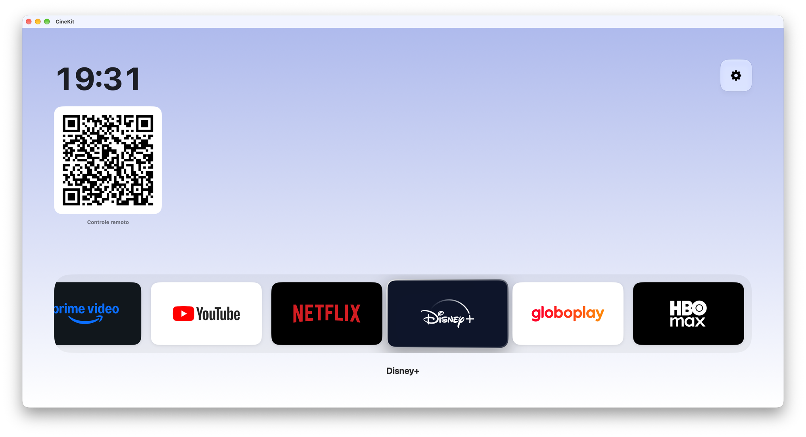
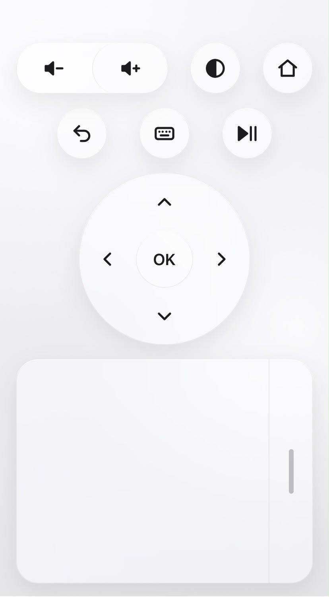

<p align="center"></p>

<h1 align="center">CineKit</h1>

<p align="center">Transforma o Mac numa TV box: interface de sala em tela cheia, controle remoto pelo celular e apps Android.</p>

<p align="center">
  <a href="https://github.com/GuilhermeMendesRosa/cine-kit/releases/latest"></a>
  <a href="https://github.com/GuilhermeMendesRosa/cine-kit/actions/workflows/ci.yml"></a>
  <a href="LICENSE"></a>
  
</p>

> **Status:** MVP em desenvolvimento.

<table>
  <tr>
    <td width="76%"></td>
    <td width="24%"></td>
  </tr>
  <tr>
    <td align="center">Home no Mac</td>
    <td align="center">Controle remoto no celular</td>
  </tr>
</table>

## Recursos

- **Home de TV** em tela cheia ("10-foot UI"), com Liquid Glass, legível de longe e navegável só com as setas, OK e Voltar.
- **Serviços de streaming** abertos em WebKit, com DRM, que continuam vivos em segundo plano; YouTube com a interface de TV.
- **Controle remoto no celular** pela rede Wi-Fi: escaneie o QR nas Configurações e use setas, touchpad, rolagem, volume e teclado de texto, sem instalar nada.
- **Apps Android** (APKs sem DRM) num emulador escondido, que aparecem na home como qualquer outro serviço.
- Tema claro/escuro e Configurações navegáveis pelo controle.

## Instalação

Requer **macOS 26+** num Mac com **Apple Silicon**.

1. Baixe o `CineKit-X.Y.Z.dmg` da [última versão](https://github.com/GuilhermeMendesRosa/cine-kit/releases/latest).
2. Abra o `.dmg` e arraste o **CineKit** para **Aplicativos**.
3. Abra o CineKit. Na primeira vez o macOS bloqueia o app, porque ele não é notarizado pela Apple ([ADR 0017](architecture/0017-distribuicao-por-dmg-no-github-releases.md)). Para liberar, vá em **Ajustes do Sistema → Privacidade e Segurança**, clique em **Abrir Mesmo Assim** e confirme. Pelo Terminal, o mesmo efeito:

   ```sh
   xattr -dr com.apple.quarantine /Applications/CineKit.app
   ```

4. O suporte a apps Android é opcional: ligue em **Configurações → Android → Apps Android**. Ele baixa cerca de 1,5 GB direto do Google (sem Homebrew nem Java).

Para usar o controle remoto, o celular precisa estar na mesma rede Wi-Fi. Permita o acesso à rede local quando o macOS perguntar.

## Desenvolvimento

Requer as Command Line Tools (`xcode-select --install`) e Node 22.

```sh
scripts/bundle.sh && open .build/CineKit.app   # monta e abre o .app
scripts/dmg.sh                                 # depois do bundle: gera .build/CineKit-<versão>.dmg
```

Build, testes e armadilhas: seção "Comandos" do [`AGENTS.md`](AGENTS.md).

### Publicar uma versão

```sh
git tag v0.1.0 && git push origin v0.1.0
```

O workflow [`release.yml`](.github/workflows/release.yml) roda os testes, gera o `.dmg` e cria a Release com ele.

## Estrutura do repositório

```
.
├── README.md          # Visão geral do projeto (este arquivo)
├── AGENTS.md          # Instruções para agentes de IA (Claude Code, Codex, Cursor, etc.)
├── CLAUDE.md          # Aponta para AGENTS.md
├── LICENSE            # MIT
├── Package.swift      # Swift Package (ADR 0006)
├── assets/            # Ícone do app (AppIcon.png) e capturas de tela do README
├── Sources/
│   ├── CineKitCore/   # Lógica pura, sem SwiftUI/AppKit/WebKit
│   └── CineKit/       # App (UI)
├── Tests/
│   └── CineKitCoreTests/
├── remote/            # App web do controle remoto (React + Vite, ADR 0011)
├── scripts/
│   ├── bundle.sh      # Monta .build/CineKit.app
│   └── dmg.sh         # Empacota o .app em .build/CineKit-<versão>.dmg
├── .github/           # CI, release e modelos de issue
└── architecture/      # Architecture Decision Records (ADRs)
    ├── README.md      # Índice e processo dos ADRs
    ├── template.md    # Modelo para novos ADRs
    └── NNNN-*.md      # Uma decisão por arquivo
```

## Desenvolvimento com IA

Este repositório é **AI-first**: agentes de código são colaboradores de primeira classe.

- [`AGENTS.md`](AGENTS.md) é a fonte de verdade sobre como trabalhar aqui: convenções, comandos, regras.
- Toda decisão de arquitetura relevante vira um ADR em [`architecture/`](architecture/), para que humanos e agentes entendam o *porquê* das coisas sem depender de histórico de conversa.

## Licença

[MIT](LICENSE). O scrcpy-server (Apache-2.0) e o Android SDK (termos do Google) são baixados pelo app e não fazem parte deste repositório.
